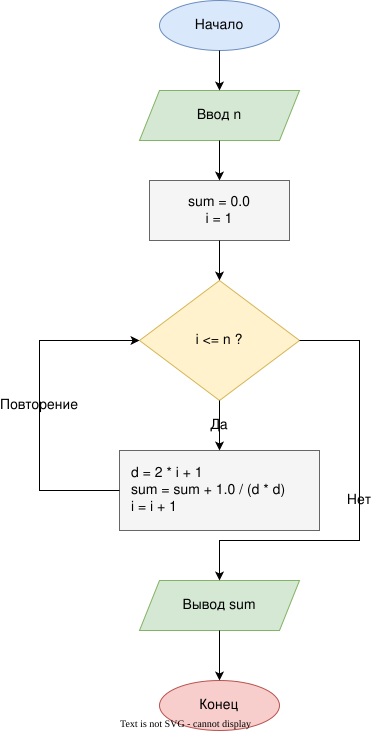

# Домашнее задание №8: Циклы с параметрами
## Условие задачи (Вариант 13)
Вычислить с использованием цикла `for` значение для заданного \(n\):
\[
 \frac{1}{3^2} + \frac{1}{5^2} + \frac{1}{7^2} + \dots + \frac{1}{(2n + 1)^2} 
\]
## Описание программы
1. Программа запрашивает у пользователя целое число \(n\) (количество членов ряда). 
2. C помощью цикла `for` вычисляется сумма. 
3. Переменная цикла `i` меняется от 1 до \(n\). Для каждого шага вычисляется знаменатель по формуле \(2i + 1\) (это дает нам 3, 5, 7 и т.д.), возводится в квадрат, и на него делится единица. Результат прибавляется к общей сумме.
4. Для хранения суммы используется тип `double`, чтобы избежать потери точности при делении.
### Блок-схема

